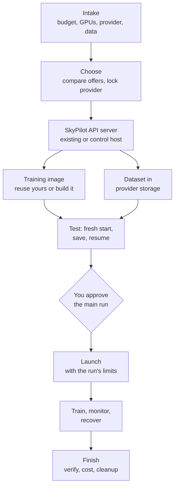
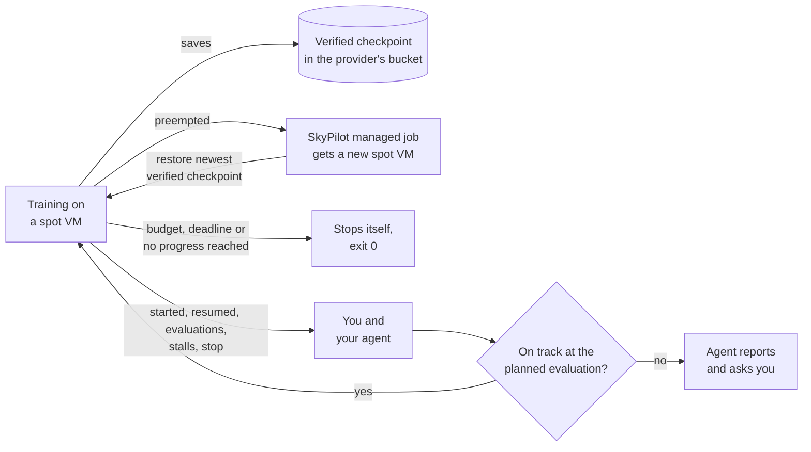

# SpotTrainer

Let your coding agent run your model training on cheap spot (preemptible) GPU instances. It picks a GPU offer, launches the run, monitors progress and spend, brings the run back after a preemption, and cleans up at the end. You approve what costs money; the agent does the rest.

I built this to spend less on renting GPUs for my own research: spot instances are much cheaper, but they get preempted, and a run needs watching. These skills let my agent handle both, so I can train on spot capacity and check in only when there is something to decide. If you rent GPUs for research training and want the same, give it a try.

Version 0.10.1 • [MIT](LICENSE) • Works with Claude Code, Codex and other hosts that read `SKILL.md` skills

## Install

Ask your agent:

```text
Install SpotTrainer from https://github.com/FrostyAlien/spot-trainer into this project, following its INSTALL.md.
```

[INSTALL.md](INSTALL.md) tells the agent what to ask, which commands to run for Claude Code or Codex, how to check the result and how to start. To do it yourself:

- **Claude Code** (2.1.275 or later): add SkyPilot's marketplace, then install; SkyPilot's official `skypilot` skill comes in as a required dependency.

  ```sh
  claude plugin marketplace add https://github.com/skypilot-org/skypilot.git --sparse .claude-plugin agent --scope project
  claude plugin install spot-trainer --marketplace https://github.com/FrostyAlien/spot-trainer.git --scope project
  ```

- **Codex** (CLI 0.162.1 or later, every project): Codex does not install plugin dependencies, so install SkyPilot's plugin first, then this one.

  ```sh
  codex plugin marketplace add https://github.com/skypilot-org/skypilot.git --sparse .claude-plugin --sparse agent
  codex plugin add skypilot@skypilot
  codex plugin marketplace add https://github.com/FrostyAlien/spot-trainer.git
  codex plugin add spot-trainer@spot-trainer
  ```

- **Codex in one project, or Claude Code without plugins:** copy the nine folders under [`skills/`](skills/) and SkyPilot's [`agent/skills/skypilot`](https://github.com/skypilot-org/skypilot/tree/master/agent/skills/skypilot) into `.agents/skills/` (Codex) or `.claude/skills/` (Claude Code) in your project, each folder whole. Your agent does this from the prompt above.

Installing only copies skill files. Nothing installs software, logs in or rents resources until you approve it during a run.

## What you need

- An AI coding agent: Claude Code, Codex, or another host that reads `SKILL.md` skills
- A GPU cloud account that [SkyPilot supports](https://docs.skypilot.ai/en/latest/getting-started/installation.html), with billing and GPU quota
- Optional: a metrics account (W&B, MLflow, ...) and a Hugging Face token for private or gated models and datasets

The agent sets up the rest with you (storage, registry, control host, image, notifications) when a stage needs it.

## Start

From your training repository, ask in plain words:

```text
Plan a spot training run for this repository.
```

In Claude Code, `/spot-trainer:start` does the same and continues a run that is already in progress.

The agent reads your repository and asks its intake questions once: budget, GPU type and count, provider, where the data is, how you want to be notified and how much it may do without asking. Then it works through the run:

1. **Choose:** compares current GPU offers by total cost of useful training, spot or on-demand, then keeps that provider for the whole run.
2. **Prepare:** a SkyPilot API server (your existing one, a provider-managed one, or a small control host), the dataset in the provider's storage and the training image. If you don't have a working image, the agent writes the Dockerfile and entrypoint around your code, builds it (on the control host, or a short-lived CPU VM when you use an existing SkyPilot server, or on your own Linux machine or CI) and checks it; if you have one, it checks it and adds only what is missing.
3. **Test:** one short run that starts fresh, saves and resumes, measuring startup time and memory. It runs first on your own GPU if you have one and want to, then once on the rented GPUs before the real run.
4. **Launch:** submits the job; the training container itself enforces the approved budget, deadline and attempt limits.
5. **Monitor:** notifications for progress milestones, preemptions, recoveries and stalls; the agent reads the metrics at planned evaluations, judges whether training is on track and reports to you.
6. **Recover:** a preempted worker is replaced on the same provider and resumes from the newest checkpoint that verifies. A run that stops making progress is stopped instead of burning budget.
7. **Finish:** verifies the final checkpoint and outputs, reconciles cost, and lists and removes exactly what the run created.

You pick how often the agent stops for approval: `automatic` (approve the plan once), `gated` (the default: approve where money is committed or something is deleted) or `steps` (approve every stage). No chat session has to stay open while training runs; the run watches itself and the agent comes back when there is something to judge.

Works with one node of up to eight GPUs, any ML framework (PyTorch, Hugging Face, JAX, Lightning, ...) and datasets up to TB scale. Multi-node is on the [roadmap](#roadmap).

## The skills

`gpu-training-lifecycle` coordinates the others; each can also be used directly.

| Skill | Use it to |
|---|---|
| `gpu-training-lifecycle` | Plan an experiment, or continue one, across all stages |
| `gpu-rental-select` | Compare current GPU offers and total cost, spot or on-demand |
| `gpu-training-controller` | Choose and connect the SkyPilot API server: your control host, an existing or provider-managed one |
| `gpu-training-image` | Build and check the training image |
| `gpu-training-data` | Put the dataset in the provider's storage and read it during training |
| `gpu-training-launch` | Run the qualification task and launch the job with its limits |
| `gpu-training-observe` | Check how a run is going: progress, spend, preemptions, stalls |
| `gpu-training-recover` | Wire checkpoint resume into training code, or diagnose a failed resume |
| `gpu-training-finish` | Verify outputs, reconcile cost and clean up exactly what the run created |

### Design choices

- **The provider stays fixed once chosen.** Recovery stays on the chosen provider and purchase mode. Spot is the main way to save, not a requirement; an on-demand fallback runs only if you approved it in advance.
- **Checkpoints you can trust after a preemption:** framework-native files in a bucket of the GPU provider, plus a `COMMITTED.json` marker written last after the checkpoint verifies. Restore picks the newest committed checkpoint that verifies and fails closed on doubt; it never silently starts over after known progress.
- **Code only where it runs unattended or checks deterministically** (the run's limits, the stall watchdog, the checkpoint verifier, the optional guard). Everything else is a runbook of CLI commands with a check after each step, built on [SkyPilot](https://github.com/skypilot-org/skypilot) managed jobs and Docker, with the SkyPilot version chosen at the start.
- **No vendor tables.** The skills ship no GPU tables or provider facts. The agent researches the chosen provider when you pick it and records dated findings in your project.

SkyPilot's official `skypilot` skill is required: these skills hand SkyPilot CLI and YAML details to it ([notes](OFFICIAL_SKYPILOT.md)).

## How it works

### The workflow



Each box is a skill you can also call on its own. Approvals depend on the level you pick at intake; in the default `gated` level the agent stops where money is committed or something is deleted.

### The training loop



- **Recovery needs no agent online.** SkyPilot replaces a preempted VM on the same provider, and the container restores the newest checkpoint that verifies.
- **The run guards itself.** At every start the training container checks the approved budget, deadline and attempts, stops cleanly when one is reached, and notifies you when it starts, resumes, evaluates, stalls or stops. Inside the VM, a stall watchdog stops a run that hangs. Nothing has to stay online next to the job, so an existing SkyPilot server (a team's, a provider-managed one, or a local one) is enough; an optional outside guard adds a limit on waiting for capacity after a preemption.
- **The agent** wakes on notifications and at planned evaluations, reads the metrics, judges whether training is on track and reports to you. It never changes code on its own.

## Roadmap

Works now:

- [x] Compare current GPU offers by total cost of useful training, spot or on-demand
- [x] One node with 1-8 GPUs, any ML framework
- [x] Build and test the training image with you
- [x] Recover from spot preemption: replacement on the same provider, resume from the newest verified checkpoint
- [x] Budget, deadline and attempt limits enforced by the run itself, and notifications from the worker
- [x] Runs on your own control host, or on an existing, provider-managed or local SkyPilot server (live-tested on Nebius's managed server)
- [x] Stall watchdog that stops a hung run instead of letting it bill
- [x] Agent check-ins at planned evaluations: progress, spend and training quality
- [x] TB-scale datasets in the provider's storage, or read from Hugging Face at a pinned revision
- [x] Finish: verify outputs, reconcile cost, clean up exactly what the run created
- [x] Claude Code plugin and install by prompt

Next:

- [ ] Multi-node training
- [ ] Live test of reusing your own image and of the local test on your own GPU
- [ ] Live test with 8 GPUs on one node
- [ ] Spot price cap through a provider pricing policy (Nebius), live test
- [ ] Live test of a worker limit stop and its relaunch, and of the ordered on-demand fallback
- [ ] Live test of the guard's on-demand fallback and cancel paths
- [ ] Control-plane backup and restore

Providers: SkyPilot supports many clouds. A provider is checked off once a full run (qualify, launch, preemption and recovery, finish) has passed on it; the agent researches any other provider when you pick it.

- [x] Nebius (L40S spot)
- [ ] AWS
- [ ] Google Cloud
- [ ] Azure
- [ ] RunPod
- [ ] Lambda
- [ ] Other SkyPilot clouds

Test details: [VALIDATION.md](VALIDATION.md).

## Repository layout

```
skills/<name>/          the nine skills: SKILL.md, references/, scripts/, assets/, agents/openai.yaml (Codex UI metadata)
tests/                  offline tests per skill, root release checks, tests/linux/ watchdog scenarios in Docker
.claude-plugin/         Claude Code plugin and marketplace manifests
commands/start.md       the plugin's /spot-trainer:start shortcut
INSTALL.md              install and first-use steps for agents
OFFICIAL_SKYPILOT.md    the required official SkyPilot skill and how it fits
VALIDATION.md, SKILL_INDEX.md, SHA256SUMS
```

## Development

Run the offline checks (no network, no cloud):

```sh
python3 -m unittest discover -s tests -p 'test_*.py'
for d in tests/*/; do [ "$d" = tests/linux/ ] || python3 -m unittest discover -s "$d" -p 'test_*.py'; done
```

Optional: `SKY_BIN=<path to sky> python3 -m unittest discover -s tests -p 'test_runbook_commands.py'` checks runbook commands against an installed SkyPilot CLI, and `tests/linux/run.sh` runs the watchdog's Linux scenarios in Docker (CPU, about 15 minutes).

[AGENTS.md](AGENTS.md) describes the conventions for changing the skills, for humans and coding agents alike. Issues and pull requests are welcome; please open an issue before a large change.

## License

MIT; see [LICENSE](LICENSE). The official SkyPilot skill referenced here is a separate Apache-2.0 project by the SkyPilot contributors and is not redistributed.
